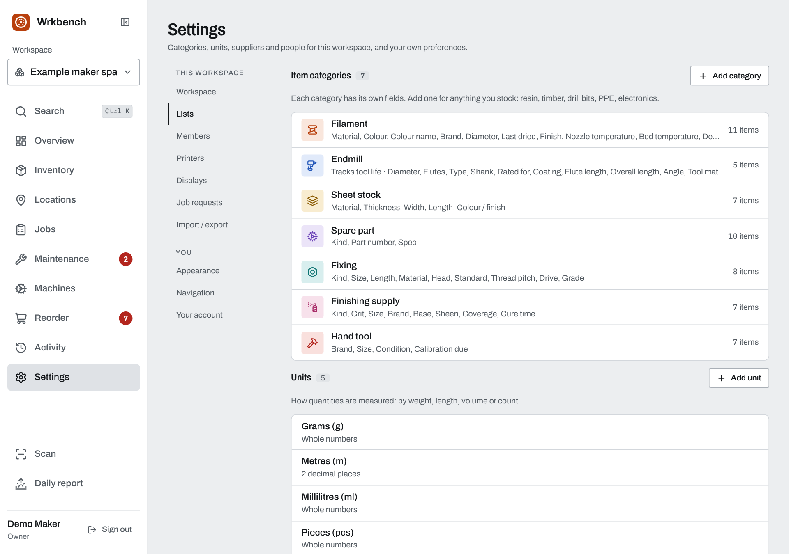

# Catalogue and settings

**Settings** holds what shapes a workspace: its categories, units, places, suppliers and people. Most of it is set up for you by a template, and all of it can be changed. Changing settings needs an admin, and a few things need an owner.

Its sections come in two groups. **This workspace** is shared by every member. **You** (Appearance, Navigation and Your account) belongs to whoever is signed in, and anyone can change their own.

## Categories

**Settings**, **Lists** holds your categories, units, machine types and suppliers together on one page, one after the other. Categories come first: they are the kinds of thing you stock. Add one for anything you keep: resin, timber, drill bits, PPE, electronics.

Each category has:

- a name, an icon and the unit its items are **usually measured in**;
- **fields**: the details you record for every item of that category. A field can be **Text**, **Number**, **Choice from a list**, **Yes / no**, **Colour** or **Date**. Mark a field **Required**, or **Show in lists** to see it on item cards;
- **Size of the piece**: mark the fields that give a piece's size (length, width, thickness) to switch on the "will it fit" search and offcuts. See [Offcuts](Inventory.md#offcuts);
- **Track tool life**: for tooling that wears. See [Tool life](Inventory.md#tool-life).

Removing a field hides its values on existing items.

## Units

Found under **Settings**, **Lists**. How quantities are measured: by weight, length, volume or count. Each unit has a name (Kilograms), a symbol (kg), and how many **decimal places** to show (0 for whole numbers).

## Machine types

Found under **Settings**, **Lists**. Group similar equipment, such as "FDM printer" or "Laser cutter". A maintenance task set on a type covers every machine of that type. See [Maintenance](Maintenance.md).

## Locations

Rooms, shelves, drawers and bins, nested as deep as you like (a bin **inside** a shelf **inside** a room). They are not under Settings: they have a page of their own, **Locations** in the main menu, where you also see what is stored in each, put things away and print their labels. See [Locations](Locations.md).

## Suppliers

Found under **Settings**, **Lists**. Where you buy from, with an optional website, email and notes. The [reorder list](Inventory.md#reordering) is grouped by supplier.

## Workspace

The workspace's name, description, **Currency** and **Target margin**. Only an owner can change these.

**Target margin** is the share of a project's price you want left as profit, from 0 to 95%. It starts at 40%. Wrkbench uses it to recommend a price for any project that has none yet. See [Projects](Jobs-and-queue.md#projects).

**Leave or delete** is also here. See [Members and roles](Members-and-roles.md#leave-a-workspace).

## The other sections

| Section | Guide |
| --- | --- |
| **Members** | [Members and roles](Members-and-roles.md) |
| **Printers** | [Connecting printers](Connecting-printers.md) |
| **Displays** | [Location displays](Location-displays.md) |
| **Job requests** | [Job requests](Job-requests.md) |
| **Import / export** | [Backups, import and export](Backups-and-data.md) |
| **Appearance** | [Below](#appearance) |
| **Navigation** | [Below](#navigation) |
| **Your account** | [Below](#your-account) |

## The built-in catalogue

Wrkbench ships with a catalogue of real machines and materials that you can add in one step: 3D and resin printers, lasers, CNC routers and mills, vinyl cutters, finishing and extraction equipment, filament, sheet stock, endmills, fixings and fasteners, and finishing supplies.

Use **From the catalogue** when adding a machine or an item, or pick **Your machines** while creating a workspace.

- **A machine** arrives with its specs, its feeders or tool changers (as attached hardware with slots), its machine type, and that type's maintenance schedules.
- **An item** arrives in the matching category. The category gains any fields and choices it needs.

Adding from the catalogue copies the entry into your workspace. After that it is ordinary data you can change freely, with no link back to the catalogue. Admins and owners can add from the catalogue.

Filament data comes from [SpoolmanDB](https://github.com/Donkie/SpoolmanDB). Something missing or wrong in the catalogue? See [CONTRIBUTING.md](../../CONTRIBUTING.md#the-built-in-catalogue).

## Appearance

**Settings**, **Appearance** sets your own look: **Light**, **Dark** or **Match device**, a palette, and an **Accent colour** for buttons and selected items. Warning and status colours never change, so alerts always look the same. Your choice is saved to your account and follows you to any device.

## Navigation

**Settings**, **Navigation** is your own layout for the main navigation. It is saved to your account, follows you to any device, and does not change what other members see.

- **Order**: drag a page, or use the arrows, to put the pages you use most at the top.
- **Where a page shows**: each page has a switch with **Both**, **Desktop**, **Phone** and **Hidden**. **Desktop** keeps it only in the sidebar on a computer, **Phone** only in the phone navigation, and **Hidden** takes it out of both. **Settings** always stays on **Both**.
- **Phone tab bar**: tick up to four pages for the bar at the bottom of a phone. The rest are under **More**. A page that does not show on a phone cannot be in the bar.
- **Reset to standard** puts back the original order and shows every page everywhere.

A hidden page is only out of the navigation. It still opens from a link, a bookmark or a scanned label.

## Your account

**Settings**, **Your account**:

- **Daily report**: untick **Open the daily report on my first visit each day** to stop it opening by itself. See [the daily report](Dashboard-and-reports.md#daily-report).
- **Change password**. The new one needs at least 12 characters; see [Choosing a password](Getting-started.md#choosing-a-password). This signs you out everywhere else.
- **Passkeys**: add, rename and remove the passkeys that sign you in with your fingerprint, face or screen lock. See [Passkeys](Getting-started.md#passkeys).
- **Other devices**: sign out every device except this one, for example after using a shared computer.
- **Delete account**: removes your account and every workspace that only you belong to. Workspaces you share stay with the other members. If you are the only owner of a shared workspace, make someone else an owner first.

Forgot your password? Use **Forgot password?** on the sign-in page. The link it emails works once, for one hour.
