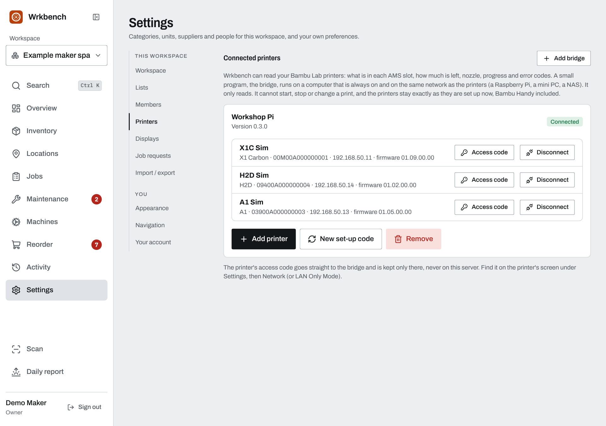

# Connecting printers

Wrkbench can read Bambu Lab printers: every AMS and what is in each slot, how much filament is left on tagged spools, humidity and drying, nozzle, print progress and error codes.

It only reads. Nothing here can start, stop or change a print, and the printer stays set up exactly as it is now: cloud mode, Bambu Studio and Bambu Handy all keep working. You do not need LAN-only mode or Developer Mode.

New to the words used here (bridge, AMS, access code)? See the [Glossary](Glossary.md).

## How it works, in one paragraph

A printer can only be reached from its own network, and Wrkbench runs somewhere else. So a small program, the **bridge**, runs on a computer in your workshop. It talks to the printers on one side and makes a single outgoing connection to Wrkbench on the other. You do not open any ports on your router.

```
printer  <-- your network -->  bridge  -- outgoing connection -->  Wrkbench  -->  your browser
```

## Before you start

You need:

- **An admin or owner account** in the workspace. (Guest sessions cannot add a bridge.)
- **A computer for the bridge** that is always on and on the same network as the printers: a Raspberry Pi, a mini PC, a NAS, or a desktop that stays on. It needs either Docker, or Node.js 22.9 or newer.
- **Each printer's access code.** On the printer's screen: **Settings**, then **Network** (on some models **Settings**, **General**, **LAN Only Mode**). It is 8 characters. You do not have to switch LAN Only Mode on; you only need to read the code.
- If printers are not found automatically, each printer's **address** (same Network screen, for example `192.168.1.50`) and **serial number** (**Settings**, then **Device**).

One bridge serves up to 20 printers. A workspace can have up to 3 bridges, for printers on separate networks.

## Step 1: add a bridge in Wrkbench

1. Open **Settings**, then **Printers**.
2. Press **Add bridge**.
3. Give it a name that says where it runs, such as "Workshop Pi", and press **Add and show set-up command**.

The bridge now appears as **Not set up**, with a command to copy. The command contains a one-time code that works **once, for 10 minutes**. If it runs out, press **New set-up code**.

## Step 2: run the command on the bridge computer

Pick whichever fits the computer. On a Mac or Windows PC use the second option: Docker there cannot see printers on your network.

**With Docker (recommended).** Paste the first command into a terminal on the bridge computer. It looks like this (always copy the one Wrkbench shows, which has your own address, code and image):

```
docker run -d --name wrkbench-bridge --restart unless-stopped --network host \
  -v wrkbench-bridge:/data ghcr.io/hussxin5046/wrkbench-bridge:latest \
  --server https://your-wrkbench-address --pair ABCD-EFGH-JKMN
```

- `--restart unless-stopped` starts it again after a reboot.
- `--network host` lets it hear printers announce themselves. Without it, add printers by address (step 3, "by hand").
- `-v wrkbench-bridge:/data` keeps its settings through updates. Do not leave it out.

If the image has not been published yet, build it once from a copy of the repository: `docker build -f bridge/Dockerfile -t wrkbench-bridge .` and use `wrkbench-bridge` as the image name in the command.

**Without Docker.** On a computer with Node.js 22.9 or newer and a copy of the repository:

```
npm install
npm run bridge -- --server https://your-wrkbench-address --pair ABCD-EFGH-JKMN
```

Leave it running. To have it start by itself, run it under whatever you use for services (systemd, pm2, Task Scheduler). After the first run it needs no options: `npm run bridge`.

Either way, the bridge prints `Paired with "<your workspace>"` and then `Connected to ...`.

## Step 3: check the bridge is connected

Back in **Settings**, **Printers**, the bridge's badge changes to **Connected** by itself within a few seconds, and **Add printer** becomes available.



If it stays **Not set up**, see [When something is wrong](Bridge-reference.md#when-something-is-wrong).

## Step 4: add a printer

1. Press **Add printer** on the bridge.
2. Wait a moment for the list. Printers announce themselves every few seconds; press **Look again** if yours is not there yet.
3. Pick your printer from the list.
   - Not listed? Press **Enter address and serial number by hand** and type both.
4. Type the printer's **Access code**.
5. Under **Machine in Wrkbench**, choose the machine this printer already is in your workspace, or leave **Add as a new machine** and give it a name. If a machine already carries the same serial number it is chosen for you.
6. Press **Connect**.


Wrkbench has the bridge try the code against the printer before saving anything. It takes a few seconds. If the code or address is wrong you are told straight away and nothing is saved.

Repeat for each printer.

## Step 5: see it working

Open **Machines**. The printer's card now shows:

- a grey panel with what it is doing: state, the print's name and progress, time left, nozzle size and type, temperatures, and any error codes (each links to the maker's explanation);
- its AMS units as attached hardware, marked "read from the printer", with humidity and temperature;
- each slot showing what the printer sees in that tray.


Slots that say **Not linked to stock** hold a spool Wrkbench cannot yet tie to an item. Linking them is one tap each: see [AMS and spools](AMS-and-spools.md).

## What is stored where

- **The access code** passes through Wrkbench once, on its way to the bridge. It is kept only in the bridge's own settings file on the bridge computer. Wrkbench never stores it.
- **Wrkbench stores** the printer's serial number, model, firmware version, address on your network, and its last reported status.
- **The bridge** only connects to addresses on a private network, and cannot send a printer anything except "send me your status". It remembers each printer's certificate and will not hand the access code to a different device that turns up at the same address.

## Changing things later

| To do this | Do this |
| --- | --- |
| The printer has a new access code or address | **Settings**, **Printers**, **Access code** on that printer |
| Stop reading a printer | **Disconnect**. The machine, its AMS units and what is loaded all stay; they just stop updating |
| Move the bridge to another computer | **New set-up code**, run the command on the new computer, then re-enter each printer's access code |
| Remove a bridge | **Remove**. Its printers are disconnected; nothing else is deleted |

## Good to know

- This reads the printer the same way community tools do, not through an official Bambu Lab interface. A printer firmware update can change or break it.
- The reading was written from public notes on how the printers report, and has since been checked against recordings from a real X2D (with an AMS 2 Pro, an AMS HT and two outside spool holders) and a real H2D with a 40 W laser. Other models, and automatic discovery, are not yet confirmed on real hardware. If something on screen does not match the printer, the [record command](Bridge-reference.md#recording-what-a-printer-reports) captures what is needed to fix it.
- Prints are followed as jobs and the filament they use is taken from stock: see [Prints and filament use](Prints-and-filament-use.md). Wrkbench only reads printers; sending a job to one is not built.
