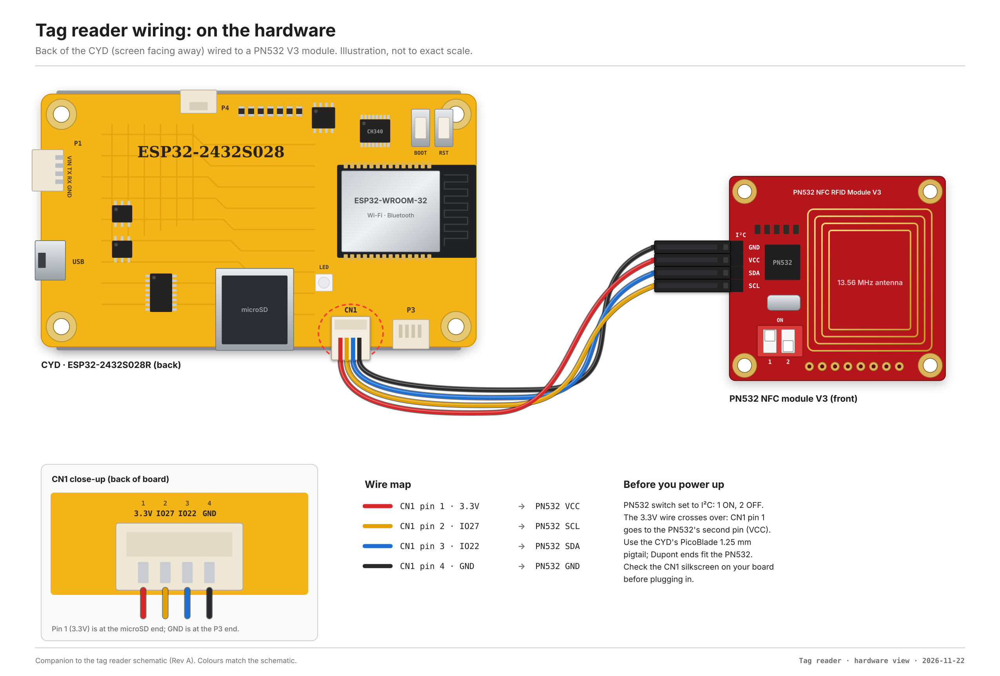

# Location displays

A location display is a small touch screen fixed to a shelf, rack or dry box. It shows what is stored there and how much of each is left, with anything running low at the top, and updates by itself. Items in a location inside it (a shelf in a rack, say) are shown too, with a small "at Shelf 2" note.

Give it a printer and it also shows what that printer is doing. With an optional tag reader fitted, tapping a spool's [sticker](Spool-tags.md) on the display shows that spool, and can put it away there, mark it as the next spool going into the printer beside it, or link a new sticker to an item.

## What to buy

- **The display**: an ESP32-2432S028R, sold as the "Cheap Yellow Display" or CYD. Get the **2.8 inch version with a USB-C port**. They cost little and need no soldering. A **2.4 inch CYD with an ST7789 IPS screen** works too: flash `cyd24-st7789` instead.
- **A USB-C cable and a USB power supply** to run it. A phone charger is enough.
- **Optional, a tag reader**: a PN532 NFC module (the common red or blue board) and four jumper wires. Set the module's switches to **I2C**. Readers on SPI, such as the RC522, are not supported: the CYD has no free pins for them.

## Flashing it

The display needs Wrkbench's firmware put on it once. The easiest way is from Wrkbench itself, in **Chrome or Edge on a computer** (other browsers and phones cannot reach USB devices):

1. Plug the display into the computer with a USB cable.
2. In **Settings**, **Displays**, choose **Flash a new display** (admins and owners).
3. Choose the kind of board. Leave **Set it up over USB too** on, and fill in the display's name, the location it shows, and your workshop's Wi-Fi name and password.
4. Press **Connect, flash and set up** and pick the board's USB port when the browser asks (often "USB-SERIAL CH340").

It flashes the newest firmware, adds the display, and sends it your Wi-Fi, this server's address and a set-up code over the cable. The display restarts, joins the Wi-Fi and shows its location; its card turns to **Connected** within a minute or two, and you can unplug it from the computer. The Wi-Fi password goes from the page to the display only, never to Wrkbench. With **Set it up over USB too** off, it only flashes, and you set it up from a phone as below.

- **"The board did not answer"**: some boards do not go into flashing mode by themselves. Hold the board's **BOOT** button, press and release **RST**, let go of BOOT, and try again.
- **No port is listed**: the computer may need the driver for the board's USB chip (CH340 on most CYDs).
- **Colours look wrong after flashing** (white looks black, or everything looks like a photo negative): flash again and choose the other 2.8 inch kind of screen.
- **It did not take its set-up over USB**: the page says why, adds the display anyway and shows its set-up code; finish from a phone as below.

You can also flash from the command line with PlatformIO: see [firmware/README.md](../../firmware/README.md) (`pio run -d firmware/cyd -e cyd-st7789 -t upload`).

## Setting it up

A display flashed with **Set it up over USB too** is already set up. Otherwise, or after **Set up again**, set it up from a phone:

1. In Wrkbench, open **Settings**, then **Displays**, and choose **Add display**. Give it a name ("Rack A display") and choose the location it shows. Wrkbench shows the server's address and a set-up code. The code works once, for ten minutes. Admins and owners can add displays; a workspace can have up to five.
2. Power the display. It shows the name and password of its own Wi-Fi network, **Wrkbench-** followed by four characters. Join it from your phone. A set-up page opens (if it does not, go to `192.168.4.1`).
3. On that page choose your workshop's Wi-Fi and type its password, then the **Wrkbench address** and the **set-up code** from step 1. Save.

The display joins your Wi-Fi, swaps the code for a key of its own, and shows the location within a minute. In Settings its card turns to **Connected**.

If the code was mistyped or has run out, the display shows a keyboard: make a new code in Settings and type it in there.

**The address** must be one the display can reach over your Wi-Fi:

- On the hosted Wrkbench, it is the address you use in the browser.
- On your own copy, use the address other devices on your network reach it at, such as `http://192.168.1.20:4000`, never `localhost`. Settings warns when the address it would show is `localhost`; set `APP_URL` on the server to fix it for good.
- A self-hosted `https://` address with a certificate of its own (not Let's Encrypt or another public authority) is refused unless you tick **Accept any certificate** on the set-up page.

## Using it

- **Scroll** the list with a finger. Each row has the item's colour, name, material and brand, the amount left and, when the item has a full amount set, a bar.
- **Tap the top bar** to look at another location. After two minutes untouched it goes back to its own.
- **Hold the top bar** for details: the display's name, workspace, server, Wi-Fi signal and firmware. From there **New code** asks for a new set-up code, and **Set up again** (press twice) forgets everything, Wi-Fi included.
- The dot at the top right is green while it is up to date and orange when it cannot reach Wrkbench. It keeps showing what it last had, with "Offline, updated 5 min ago", and tries again by itself.
- The screen dims after five minutes untouched.
- At most 40 items are listed; "+12 more in Wrkbench" says how many are left out.

## The printer beside it

When a display has a **Printer beside it** (see below), a line under the top bar shows that printer: a dot, its state and, while it prints, how far along it is and the time left, with a thin progress line. The dot is blue while it works, green when idle or finished, orange when paused or warning, red when it has stopped or reports a fault, and grey when it is not reporting (the line then says why, such as "Bridge offline"). Updates come every 15 seconds while it prints.

Tap that line for the printer's own screen: progress and time left, the job's name and layer, a dial each for the nozzle and bed temperatures (blue while heating, green at the set temperature, orange while still hot with the heater off), the printer's worst error in red, and up to eight spools along the bottom (A1 is AMS 1 slot 1) with the one feeding now outlined. Tap the top bar to go back; it also goes back by itself after two minutes. On a printer with two nozzles (H2D, X2D), the nozzle dial shows the one printing now.

The status comes from a [connected printer](Connecting-printers.md), so it needs a bridge. A machine that is not connected to one shows "Not connected".

## Changing what it shows

In **Settings**, **Displays**, each display has:

- **Shows**: the location. It changes on the display within half a minute.
- **Printer beside it**: its status shows on the display (see below), and it is the printer used for "going into the printer" when a spool is tapped.
- **Allow changes from this display**: on by default. When it is off, tapping a tag only shows the spool.
- **Rename**, **New set-up code** (to set it up again, say after it was reset) and **Remove**. Removing a display stops it at once: its screen goes back to asking for a code.
- Its **firmware** version, and **Update to …** when newer firmware has been published for its kind of board.

## Updating its firmware

New firmware for displays is published from time to time. When there is some for a display, its card in **Settings**, **Displays** says so and has an **Update to 0.3.1** button (for admins and owners).

1. Press **Update**. The display picks it up within half a minute, while it is connected.
2. Its screen shows **Updating firmware** and how far along the download is, then it restarts on the new firmware. It takes a minute or two; leave it plugged in.
3. Its card shows the new version once the display is back.

Nothing is lost: the display keeps its Wi-Fi, its set-up and what it shows.

- **If the download fails** (the Wi-Fi drops, say), the display keeps its old firmware and the card says why. Press **Update** to try again.
- **If the new firmware will not start**, or restarts before it has reached Wrkbench, the display goes back to the firmware it had, and the card says it went back. It does this by itself; unplug it and plug it in again if it seems stuck. Once it has reached Wrkbench, or run for ten minutes, it keeps the new firmware.
- **Stop waiting** on the card withdraws an update the display has not started yet, such as one for a display that is switched off.
- Displays on firmware older than 0.3.0 cannot update themselves: flash them from a computer once (see [Flashing it](#flashing-it)), and every update after that comes from Settings.

On your own server, see [Self-hosting](Self-hosting.md) for where the firmware comes from.

## The tag reader

Wire the PN532 to the CYD's 4-pin connector marked **CN1**: 3.3V to VCC, GND to GND, **IO22 to SDA** and **IO27 to SCL**. The display finds the reader when it starts; without one it is a plain location display. Settings shows "tag reader connected" on its card.

Hold a spool to the reader, by its NFC [sticker](Spool-tags.md) or, for a Bambu Lab spool, by the spool's own tag (on the side of the spool, near the hub). Keep it still until the card appears.

### A tap tags the spool in or out

What a tap does depends on where Wrkbench thinks the spool is:

| The spool is | A tap | The card says |
| --- | --- | --- |
| Kept in this display's location, or in a location inside it | Takes it out. It is now **on the move** | **Taken out: on the move** |
| Anywhere else, or on the move | Puts it away in this display's location | **Put away in** and the location |

The card also shows the spool's colour, name and amount left, and closes by itself after 20 seconds. It offers:

- **Put away here**, after taking a spool out: puts it straight back, if the tap was a mistake.
- **Into X1C** (the printer chosen as beside the display): marks it as the next spool going into that printer, the same as [scan, then insert](Spool-tags.md#scan-then-insert). Put it in within two minutes. You rarely need this: see [Into a printer](#into-a-printer).

With **Allow changes from this display** switched off, a tap only shows the spool. A Bambu Lab spool that is not in stock is named on the card, but no notice is left in **Inventory**.

Changes made from a display appear in the [activity log](Dashboard-and-reports.md) under the display's name.

### On the move

A spool taken out at a display has no location: it is **on the move**. It shows that way in the inventory and on the spool itself, and **Inventory** has an **On the move** filter while any spool is.

It stops being on the move when:

- it is tapped on a display, which puts it away there;
- you put it away by hand (see [Locations](Locations.md#put-things-away));
- it is loaded into a machine.

### Into a printer

When a connected printer reports a spool newly put into an AMS slot or onto the outside spool holder, Wrkbench looks at the spools on the move:

- **A Bambu Lab spool** is known by its tag, and is loaded into that slot.
- **Any other spool** is described by the material and colour set on the printer's screen. If exactly one spool on the move fits, it is loaded into that slot. If the printer reads a tag on it that Wrkbench has not seen, the spool gets that tag.
- **If two or more spools on the move fit** (two black PLA spools out at once), Wrkbench loads neither and says so in the activity log. Choose the spool in the slot yourself: see [AMS and spools](AMS-and-spools.md#linking-a-spool-the-one-tap).

A spool taken out of a printer that has no location is on the move again, until it is tapped in at a display. This only happens in workspaces where a display has a tag reader.

### Tags Wrkbench does not know

- **A sticker that is not linked to anything**: **Link to an item** lists the untagged items in this location; choose one and confirm. The sticker is then that item's.
- **A Bambu Lab spool that is not in stock yet**: the card says **Not in stock yet** and what the tag says it is. **Link to an item** works here too, when the spool is already in stock without a tag and kept in this location. Otherwise sort it out in Wrkbench: **Inventory** shows a notice with **Sort it out**. There you choose the spool the tag is on, press **Add as a new spool** (the form is filled in from the tag: material, colour and size), or press **Not one of ours** to forget the read. The spool is put in the location of the display it was tapped on.

Adding a spool needs an admin or owner. Operators can tie a tag to a spool in stock and forget a read.

### Which tags are read

- **NFC stickers** written by Wrkbench, and tags whose id was typed in by hand.
- **Bambu Lab spools' own tags.** The display unlocks the tag and reads the spool's id from it, the same id the printer reports for that spool, so a spool the printer has already recognised is known at the display without doing anything. The tag says what the spool was when it was made, not how much is left: that comes from the printer or from you.

A spool that carries the printer's own tag cannot be given a sticker from the display, so the printer keeps recognising it.

## What the display can do

A display has its own key, separate from any member's sign-in. With it, it can read the items, locations and amounts of its workspace. While **Allow changes** is on, it can also take a tapped spool out of its location or put it away there, mark a spool for its printer and link tags to items kept in its location. It cannot change amounts, delete anything or reach any other part of Wrkbench. If a display is lost, **Remove** it in Settings and its key stops working at once.

## Troubleshooting

| What you see | What to do |
| --- | --- |
| Colours look wrong or like a negative | Flash the other kind of screen (`cyd-ili9341`). |
| Taps land in the wrong place | See "Touch lands in the wrong place" in [firmware/README.md](../../firmware/README.md). |
| "Joining Wi-Fi" for a long time | The Wi-Fi is out of reach or its password changed. Use **Set up again** (press twice) and set it up from your phone. |
| "Cannot reach Wrkbench" | Check the address from a phone on the same Wi-Fi. On your own copy, check the computer's firewall lets port 4000 in. A wrong address: **Set up again**. |
| "That set-up code is not valid or has run out" | Make a new code in Settings, Displays, and type it on the display's keyboard. |
| "This display was removed or set up again" | It was removed in Settings, or set up again with a new code. Make a new code. |
| A Bambu Lab spool the printer already knows shows **Not in stock yet** | The id on the tag is not the one Wrkbench has for the spool. Link the tag to its spool once, with **Sort it out** in **Inventory**. The display cannot do this one: it never replaces a tag the printer uses. |
| A tap shows the spool but changes nothing | **Allow changes from this display** is off, or the display has no location. Check both in Settings, Displays. |
| Accented letters look plain ("Cafe") | The display's fonts have plain letters only; names are shown without accents. |

## Good to know

- **Checked so far:** on a real 2.8" USB-C board (ST7789 panel), set-up from a phone, pairing with an `https://` server, showing a location's items, the printer status (with a simulated printer) and picking up again after the server restarted all work. Still to try on real hardware: the tag reader (the code has not met a real PN532 yet), a real printer's status, a Wi-Fi outage, and removing a display in Settings.
- **Bambu Lab tags have not been read on real hardware yet.** Tapping in and out, spools on the move and matching them to a printer were checked by sending Wrkbench what a display sends, and the keys that unlock a tag were checked against an independent calculation. The first thing to try: tap a spool the printer has already recognised. If the card says **Not in stock yet**, the id on the tag is not the one the printer reports; link the tag to its spool once with **Sort it out** in **Inventory** and it is known from then on.
- The display asks for updates every 30 seconds; when nothing changed the answer is a few bytes.
- On your own server, `DEVICES_ENABLED=false` switches displays off and `DEVICE_MAX_PER_WORKSPACE` changes the limit of five. See [Self-hosting](Self-hosting.md).
