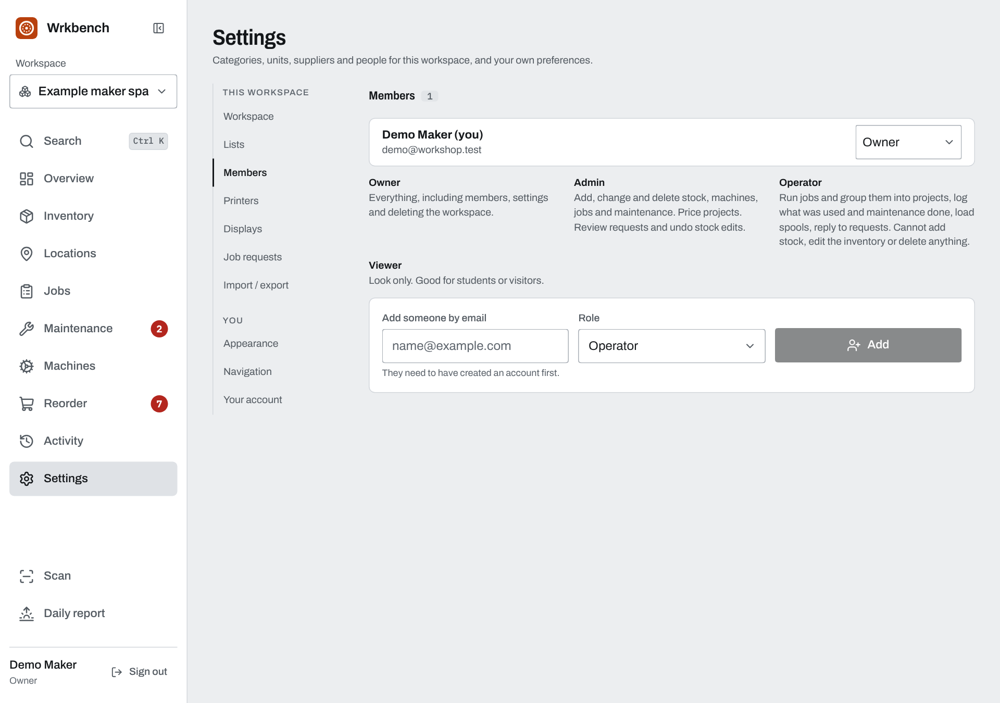

# Members and roles

A workspace can be shared with the people you work with. Each member has a **role** that decides what they can change.

## The four roles

| Role | Can |
| --- | --- |
| **Owner** | Everything an admin can, plus: add and remove members, change roles, turn the job request link on or off, change the workspace's name, currency and target margin, or delete it |
| **Admin** | Add, change and delete everything else: items, categories, machines, maintenance tasks, suppliers, locations, printers. Price projects, move them between stages and delete them. Review job requests. Undo stock changes. Import data |
| **Operator** | The day-to-day work: create, start, finish, cancel and reorder jobs; create projects and put jobs in them; take stock away (never add it); log maintenance; load and unload slots, and say which spool goes into a printer next; move items between locations; find a spool on its location display and take it out; write and tie spool tags; forget a spool read at a display; comment on job requests and move them along; ask the AI assistant questions |
| **Viewer** | Look at everything, change nothing. Viewers see the AI summary but cannot ask it questions |

Whoever creates a workspace is its first owner. A workspace can have more than one owner.

The server checks every change against the member's role, so hiding a button is never the only protection.

## Add someone

Only owners can do this.

1. The person creates their own Wrkbench account first, and opens the link in the email Wrkbench sends them to confirm their address.
2. Go to **Settings**, **Members**.
3. Under **Add someone by email**, enter the email they signed up with, choose a **Role**, and add them.

The workspace then appears in their **Workspace** menu.

If you are told **That account has not confirmed its email address yet**, the person has not opened that link. Ask them to, or to press **Send the link again** on the notice at the top of their page, then add them. This is so that only the real owner of an address can be let in to your workspace.

## Change a role or remove someone

Owners can change anyone's role from the list, or remove a member. A removed member loses access straight away; what they did stays in the [Activity](Dashboard-and-reports.md#activity) log.

## Leave a workspace

Under **Settings**, **Workspace**, **Leave or delete**, any member can leave. An owner can also delete the workspace, which removes everything in it for everyone.

If you are a workspace's only owner, make someone else an owner before you leave it or delete your account. See [Your account](Catalogue-and-settings.md#your-account).
